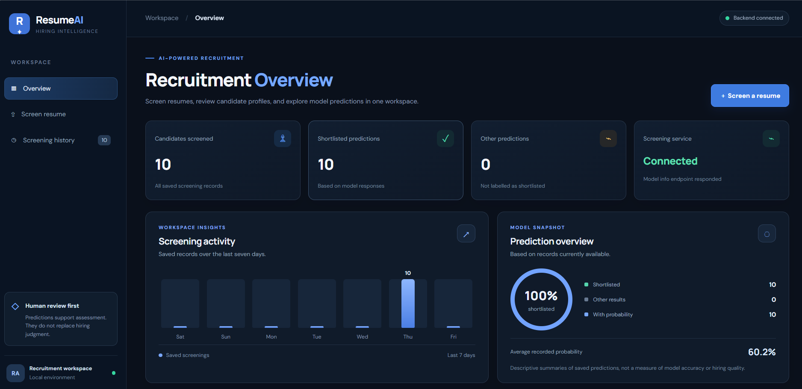
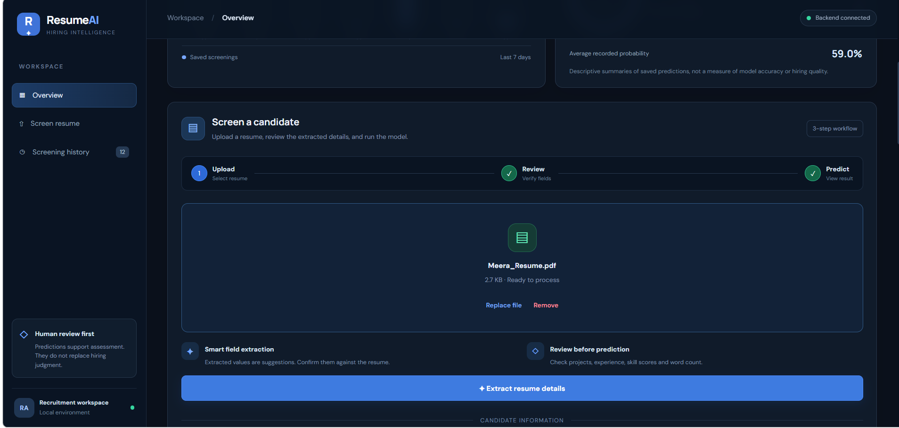
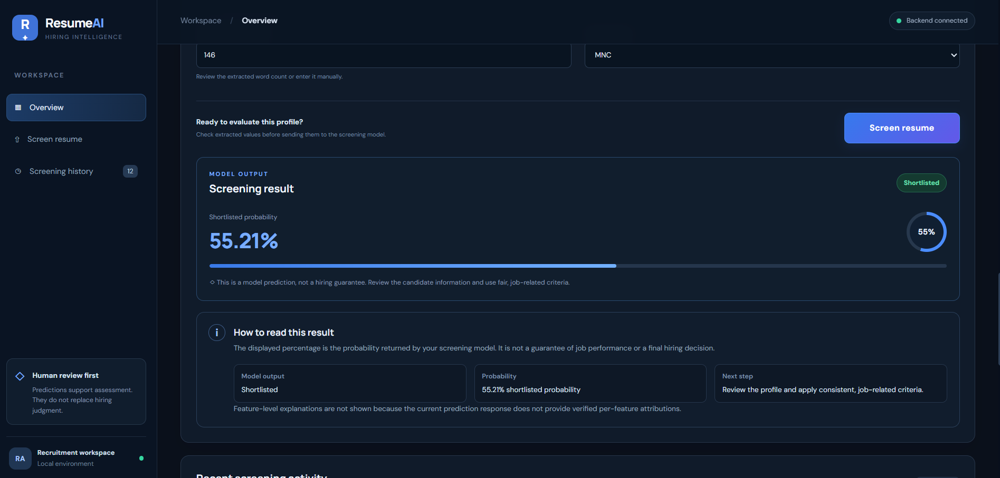
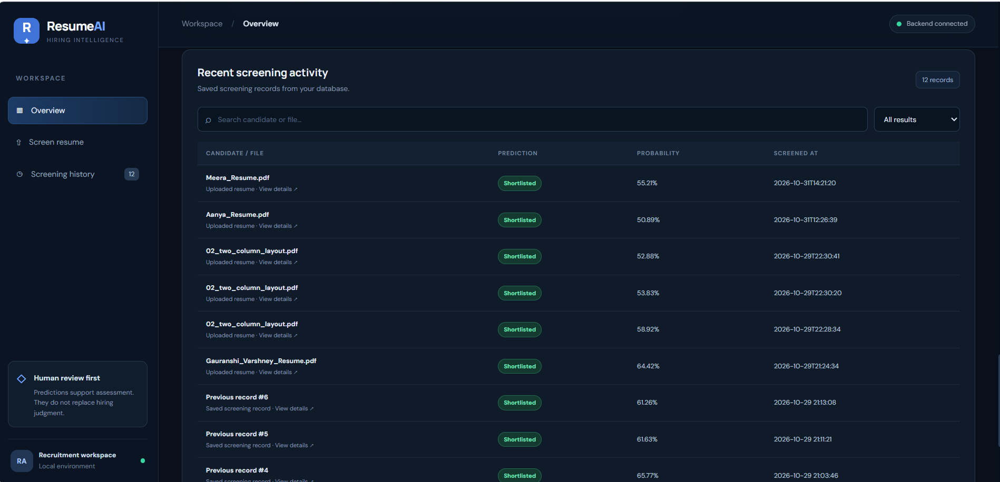

# AI Resume Screening and Candidate Shortlisting System

An AI-powered Resume Screening and Candidate Shortlisting System that
analyzes uploaded resumes, extracts candidate information, and predicts
whether a candidate is suitable for shortlisting using a Machine
Learning model.

The application provides a React-based frontend and a Python Flask
backend to make resume screening easier and more efficient.

## Features

-   Upload resumes in PDF, DOCX, JPG, JPEG, PNG, and WEBP formats.
-   Extract resume text using PyMuPDF, python-docx, and Tesseract OCR.
-   Analyze candidate information and skills.
-   Predict candidate shortlisting using a Machine Learning model.
-   View previous screening records.
-   Delete individual screening history records.
-   Store screening history using SQLite.
-   Interactive React-based user interface.
-   Flask REST API integration.

## Application Screenshots

### 1. Resume Dashboard



### 2. Resume Upload



### 3. Resume Screening -- Step 1


### 4. Resume Screening -- Step 2


### 5. Screening Result



### 6. Screening History



## Tech Stack

  Category            Technologies
  ------------------- -------------------------------------------
  Frontend            React, JavaScript, CSS
  Backend             Python, Flask, Flask-CORS
  Machine Learning    Scikit-learn, Pandas, NumPy, Joblib
  Resume Processing   PyMuPDF, python-docx, Pytesseract, Pillow
  Database            SQLite
  Development Tools   VS Code, Git, GitHub

## Project Structure

``` text
AI Resume Screening and Candidate Shortlisting System/
│
├── resume-screening-frontend/
│   ├── public/
│   ├── src/
│   ├── package.json
│   └── ...
│
├── resume_screening_backend/
│   ├── app.py
│   ├── requirements.txt
│   ├── shortlisting_model.pkl
│   ├── education_encoder.pkl
│   └── screening_history.db
│
├── Screenshots/
│   ├── resume-dashboard.png
│   ├── resume-upload.png
│   ├── resume-screening 1.png
│   ├── resume_screening 2.png
│   ├── resume_result.png
│   └── resume_history.png
│
└── README.md
```

## Machine Learning Model

The application uses a trained Machine Learning model to predict
candidate shortlisting based on resume-related features.

The model uses the following features:

-   Years of Experience
-   Skills Match Score
-   Education Level
-   Project Count
-   Resume Length
-   GitHub Activity

### Download the Model

The trained model is hosted on Hugging Face because of its large file
size.

**[Download Shortlisting
Model](https://huggingface.co/gauranshi05/resume-screening-model/resolve/main/shortlisting_model.pkl)**

After downloading, place `shortlisting_model.pkl` inside the
`resume_screening_backend/` directory.

## Installation and Setup

### Prerequisites

Make sure the following are installed:

-   Python
-   Node.js and npm
-   Git
-   Tesseract OCR

### 1. Clone the Repository

``` bash
git clone https://github.com/Gauranshi07/AI-Resume-Screening-and-Candidate-Shortlisting-System.git
cd AI-Resume-Screening-and-Candidate-Shortlisting-System
```

### 2. Backend Setup

Navigate to the backend directory:

``` bash
cd resume_screening_backend
```

Create a virtual environment:

``` bash
python -m venv .venv
```

Activate the virtual environment on Windows:

``` bash
.venv\Scripts\activate
```

Install the required dependencies:

``` bash
pip install -r requirements.txt
```

Download the Machine Learning model from the Hugging Face link above and
place it inside the backend directory.

Start the Flask server:

``` bash
python app.py
```

The backend will run at:

``` text
http://127.0.0.1:5000
```

### 3. Frontend Setup

Open a new terminal and navigate to the frontend directory:

``` bash
cd resume-screening-frontend
```

Install the dependencies:

``` bash
npm install
```

Start the development server:

``` bash
npm run dev
```

Open the local URL displayed in your terminal to access the application.

## API Endpoints

  ------------------------------------------------------------------------
  Method                  Endpoint                 Description
  ----------------------- ------------------------ -----------------------
  GET                     `/`                      Check backend status

  GET                     `/model-info`            Get Machine Learning
                                                   model information

  GET                     `/history`               Retrieve screening
                                                   history

  GET                     `/history/<record_id>`   Retrieve an individual
                                                   screening record

  DELETE                  `/history/<record_id>`   Delete a screening
                                                   record

  POST                    `/extract-resume`        Extract text from an
                                                   uploaded resume

  POST                    `/predict`               Predict candidate
                                                   shortlisting
  ------------------------------------------------------------------------

## Resume Processing

The system supports multiple resume formats:

-   **PDF:** Text extraction using PyMuPDF.
-   **DOCX:** Text extraction using python-docx.
-   **Images:** OCR-based text extraction using Tesseract.

Tesseract OCR must be installed separately on the system for image-based
resume processing.

## Important Notes

-   The trained Machine Learning model is hosted externally on Hugging
    Face.
-   Download the model before starting the backend.
-   The SQLite database stores screening history locally.
-   Dataset files, model files, environment files, and local database
    files are excluded from the Git repository where configured in
    `.gitignore`.
-   The application requires both the Flask backend and React frontend
    to be running.

## Author

**Gauranshi Varshney**

-   GitHub: [Gauranshi07](https://github.com/Gauranshi07)
-   Project Repository: [AI Resume Screening and Candidate Shortlisting
    System](https://github.com/Gauranshi07/AI-Resume-Screening-and-Candidate-Shortlisting-System)

------------------------------------------------------------------------

*Developed as a Machine Learning-based application to simplify resume
analysis and candidate shortlisting.*
